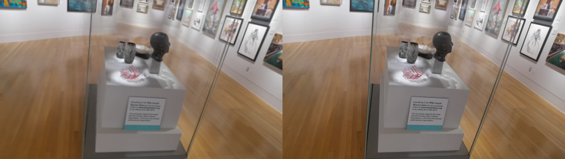

# 투명 장면의 새 시점 렌더링

**유리 진열장을 여러 방향에서 찍은 사진으로, 촬영하지 않은 위치에서 보이는 장면을 예측한다.** 유리 뒤 전시물과 표면에 비친 무늬는 카메라가 움직일 때 서로 다르게 이동한다. 이 프로젝트는 가우시안 렌더링, 두 깊이에서의 사진 정렬, 광학 흐름으로 각각 RGB 영상을 예측하고 장면별 개발 실험으로 최종 출력을 고른다. OptiX 없이 NVIDIA GPU에서 학습하고 렌더링한다.



*왼쪽은 모델이 그린 사진, 오른쪽은 해당 위치에서 촬영한 사진이다. 조형물과 받침대의 윤곽은 잘 맞지만, 받침대 안내문의 글자는 예측 영상에서 더 흐리다. 이 시점의 PSNR은 32.87 dB다.*

[한국어 기술보고서 PDF](docs/technical-report-ko.pdf) · [장면별 결과](results/summary.json) · [카메라별 점수와 개발 실험](results/fusion)

## 실험 결과

GLINT가 공개한 **Ref-DL3DV 실사 8장면의 공식 평가 시점 358개**에서 전체 RGB 영상을 480 × 270 해상도로 평가했다. 카메라별 점수를 장면 안에서 먼저 평균하고, 여덟 장면에 같은 비중을 주었다.

| 방법 | PSNR ↑ (dB) | SSIM ↑ | LPIPS ↓ |
| --- | ---: | ---: | ---: |
| GLINT · 논문 표 2 보고값 | 30.21 | 0.92 | 0.11 |
| 이 프로젝트 | **32.09** | **0.938** | **0.091** |

평균 PSNR 차이는 **+1.88 dB**다. 우리 모델은 추론할 때 주변 학습 사진을 다시 읽는다. LPIPS는 GLINT 공개 평가 코드처럼 VGG에 `[0, 1]` RGB를 넣어 계산했다. 우리 결과를 표준 `[-1, 1]` 입력으로 계산하면 **0.116**이다. [GLINT 논문 표 2](https://arxiv.org/html/2603.26181v1) · [원 저자의 LPIPS 구현](https://github.com/youngju-na/GLINT/blob/easyvolcap/easyvolcap/utils/loss_utils.py)

## 모델은 어떻게 사진을 만드나

| 경로 | 목표 카메라에서 색을 얻는 방식 |
| --- | --- |
| [가우시안 렌더링](surfels.py) | 여러 사진에서 추정한 깊이로 3차원 공간에 작은 타원형 표면을 배치한다. 위치·크기·불투명도·시선 방향별 색을 학습한 뒤 목표 카메라에 투영한다. |
| [두 깊이 합성](layered.py) | 주변 8장의 사진을 여러 깊이에서 정렬한다. 픽셀마다 두 깊이 후보의 색을 가져와 학습한 비율로 섞는다. |
| [광학 흐름](flow.py) | 사전학습된 RAFT-Large가 참조 사진 사이에서 같은 무늬가 이동한 위치를 찾는다. 카메라 포즈를 이용해 무늬를 목표 시점으로 옮긴다. |
| [최종 출력](fusion.py) | 후보 RGB와 불투명도, 후보 간 색 차이 등을 입력받아 픽셀별 가중치와 작은 색 보정량을 학습한다. 개발 PSNR로 단독 경로, 단순 평균, 학습 결합 중 하나를 선택한다. |

GLINT는 유리 경계면에서 반사·투과 광선을 추적한다. 이 구현은 래스터화와 참조 사진의 재투영으로 색을 구하므로 OptiX 드라이버가 필요하지 않다. **두 깊이 후보에는 ‘반사’와 ‘투과’라는 물리적 라벨을 부여하지 않았다.** 이번 실험의 결론은 정적 장면의 새 시점 RGB 품질에 한정된다. 유리 표면의 실제 깊이·법선 정확도와 동적 4D 장면의 시간 일관성은 후속 평가 과제다.

## 학습과 검증

장면마다 공식 학습 시점 중 12개를 개발용으로 분리했다. 가우시안과 두 깊이 합성기는 나머지 시점으로 학습했다. 개발 시점 6개로 결합기를 맞추고 다른 6개에서 출력 방식을 선택한 뒤, 개발 12개 전체로 결합기를 다시 학습했다. 최종 평가 시점은 이 과정에서 제외했다. 7개 장면은 학습 결합, `3712` 장면은 광학 흐름 단독을 선택했다. [평가 분할 검증 기록](results/protocol.json)

| 모듈 | 장면당 학습 설정 | RGB 손실 |
| --- | --- | --- |
| 가우시안 | 약 155,000개, Adam, 8,000스텝 | L1 + 0.4 × MSE |
| 두 깊이 합성기 | AdamW, 학습률 0.0015, 850스텝 | MSE + 0.04 × L1 |
| RAFT-Large | 사전학습 가중치 고정, 흐름 갱신 16회 | 추가 학습 없음 |
| 최종 결합기 | AdamW, 학습률 0.001, 단계별 600스텝 | MSE + 0.012 × L1 |

## 재현 방법

**점수만 검산하기.** 저장된 카메라별 점수와 공식 분할 YAML을 함께 제공한다. Python과 PyYAML이 있으면 GPU나 원본 사진 없이 다음 명령을 실행할 수 있다.

```bash
python -m pip install PyYAML
python summarize.py --configs configs --runs results
```

**한 장면을 처음부터 학습하기.** 검증 환경은 Linux, RTX 3090, Python 3.11, PyTorch 2.9.1+cu126, torchvision 0.24.1+cu126, GLINT용 gsplat 1.5.3이다. 공식 GLINT 설치 안내의 PyTorch와 2DGS용 gsplat을 준비하고 NumPy, SciPy, OpenCV, PyYAML, LPIPS를 설치한다. 사전학습 RAFT와 LPIPS-VGG 가중치는 첫 사용 시 내려받는다. 데이터는 공식 배포처에서 받아 압축을 푼다. [GLINT 설치 및 데이터 안내](https://github.com/youngju-na/GLINT#data-preparation)

아래에서 `REF_DL3DV`는 장면 폴더들이 들어 있는 디렉터리다. 장면 폴더에는 `images/`, `intri.yml`, `extri.yml`, `sparse/0/points3D.ply`가 있어야 한다. 저장소 루트의 Bash에서 실행한다.

```bash
export REF_DL3DV=/path/to/ref-dl3dv
SCENE="$REF_DL3DV/6b42314a2f8a18a193826e2b58e45729453e74524078283f740b8f8d330c3d2f"

python layered.py "$SCENE" --configs configs --out runs/layered --steps 850
python surfels.py "$SCENE" --configs configs --out runs/surfels --steps 8000
python fusion.py "$SCENE" --configs configs --runs runs
python fusion.py "$SCENE" --configs configs --runs runs --final
python render_view.py "$SCENE" --configs configs --runs runs \
  --view 160 --output runs/example/6b42-view160.png
```

마지막 명령은 위에서 학습한 체크포인트로 RGB PNG와 가우시안 기대 깊이·법선 NPZ를 만든다. 여덟 장면을 모두 재학습했다면 `python summarize.py --configs configs --runs runs`로 새 실행의 평균을 계산한다. 배포된 평가 기록은 `results/`, 직접 학습한 결과와 가중치는 `runs/`에 둔다.

## 참고 자료

- [GLINT · Na et al., CVPR 2026](https://arxiv.org/abs/2603.26181) — 비교 기준과 실사 장면 분할. `configs/`의 원본 라이선스는 [여기](configs/LICENSE)에 있다.
- [2D Gaussian Splatting · Huang et al., SIGGRAPH 2024](https://surfsplatting.github.io/) — 표면 가우시안 래스터화.
- [RAFT · Teed & Deng, ECCV 2020](https://arxiv.org/abs/2003.12039) — 참조 시점 간 픽셀 대응 추정.
